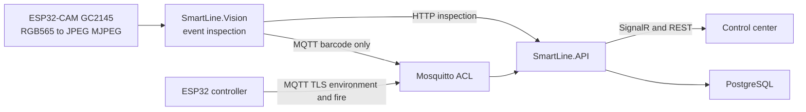
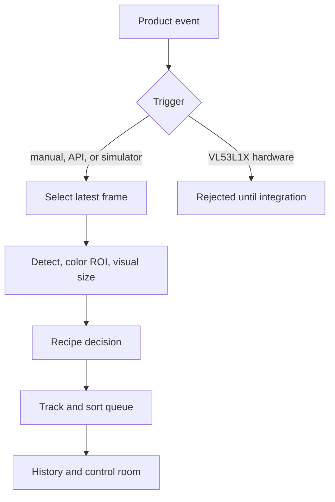
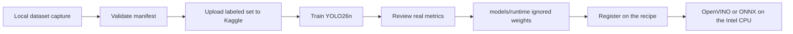
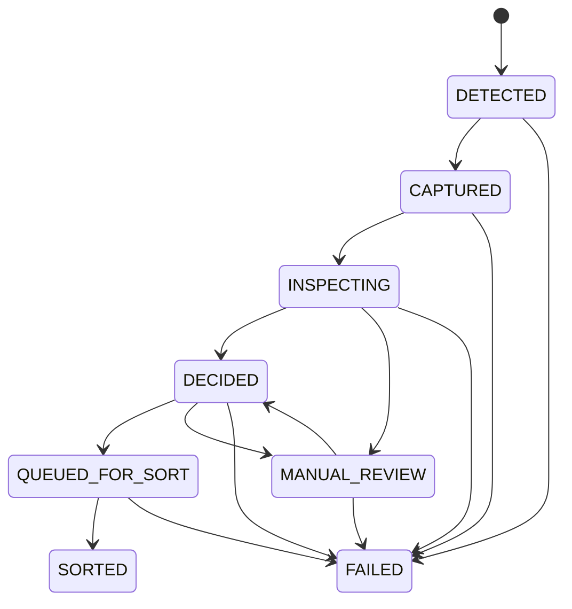
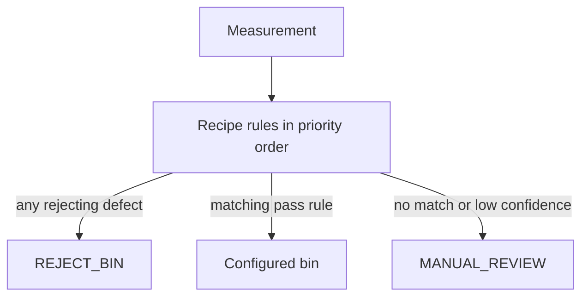

# SmartLine AI

SmartLine is an AI-assisted industrial conveyor inspection and sorting prototype. A product arrives, an inspection is triggered, one camera frame is selected, and the active Product Recipe decides the class, color, size, defects, and destination. The result is tracked along the belt, stored, and shown in the control center.

The core is recipe-driven. DemoBox is the first pipeline, with `BOX_RED`, `BOX_BLUE`, and `BOX_GREEN`. The same decision engine can later run Apple, Bag, ElectronicPart, Package, or another recipe without a rewrite.

## Architecture



Inspection does not run a model on every preview frame.









## Components

| Project | Responsibility |
| --- | --- |
| `SmartLine.API` | Identity, recipes, inspection history, tracking, dataset sessions, PostgreSQL, MQTT, SignalR |
| `SmartLine.API.Tests` | xUnit and PostgreSQL Testcontainers |
| `SmartLine.Dashboard` | Industrial control center |
| `SmartLine.Firmware` | ESP32 sensors, MQTT TLS, local emergency latch |
| `SmartLine.Cam` | ESP32-CAM MJPEG stream |
| `SmartLine.Vision` | Frame selection, barcode MQTT, event inspection |
| `training/` | Cloud training and dataset tools |

PostgreSQL, MQTT, and the API run from Docker Compose. The dashboard uses the same origin through Vite in development and Caddy in production. There is no CORS middleware. The API stays a single Minimal API instance. MediatR, Carter, a generic repository, and a unit of work are not used.

## Camera

The camera is an ESP32-CAM with a GC2145 sensor. The detected PID is `0x2145`. This sensor does not produce native JPEG. Firmware captures RGB565, converts it to JPEG in software, and publishes MJPEG.

The current live preview target is:

```text
http://192.168.1.50:81/stream
```

Live preview uses HQVGA, 240×176, so the software JPEG conversion can keep a usable frame rate. Do not raise that stream resolution to improve the preview. Dataset and inspection prefer `GET /capture/raw`, which returns the VGA RGB565 frame. Vision converts that frame to BGR on the host and encodes JPEG there. `GET /capture` remains the JPEG snapshot for a browser and for fallback. The firmware keeps the preview sensor at HQVGA. A still locks the camera, reinitializes the RGB565 buffer at the configured still size, copies the frame, and restores HQVGA before it unlocks. Changing framesize without that reinitialization is not safe on this ESP32 camera library, because the DMA buffer length is fixed at init. The default still size is VGA, 640×480, and only when PSRAM is present. Without PSRAM the still endpoints report `still_requires_psram` and do not pretend the preview frame is larger. `GET /status` reports the last capture's stage times and, separately, the last HTTP body transfer. Still and stream images are written in 2048-byte chunks staged through separate per-send internal-RAM buffers, so the independent port-80 still task and port-81 stream task cannot overwrite each other. `GET /debug/throughput` sends a fixed payload without opening the camera, from internal RAM or from PSRAM, so a slow socket can be told apart from a slow capture. The capture preparation times already measured on the board stay about two seconds. A later board measurement showed an 8192-byte internal HTTP payload finishing in 0.187 seconds, while a 32768-byte internal payload with staging took 8.358 seconds: 16 chunks, one chunk at 2865 ms, and no transport error. JPEG preparation on that run was about 2.15 seconds. Port 9001 is a separate raw TCP sender for the same 32768 internal bytes in 2048-byte writes. The normal build does not open it. That comparison is not a measured result until the development build is flashed. AI inspection stays event-triggered. It does not infer every streamed frame.

Check one connected capture without flashing. The printed stage times are measurements from the board. They are not a speedup claim until this firmware has been flashed:

```bash
python3 SmartLine.Cam/scripts/camera_smoke.py --base http://192.168.1.50:81 --captures 1 --raw
```

Measure body delivery without flashing and without a 50-capture run. A timeout is an incomplete row, not a throughput claim:

```bash
python3 SmartLine.Cam/scripts/transport_probe.py --base http://192.168.1.50:81
```

The raw TCP check needs a development build. `PLATFORMIO_BUILD_FLAGS` is appended to the existing Wi-Fi flags. The normal `esp32cam` build leaves port 9001 closed. Do not treat the printed rate as a fix until this build has been flashed:

```bash
export PLATFORMIO_BUILD_FLAGS="-DSMARTLINE_TCP_DIAG=1"
pio run --project-dir SmartLine.Cam -e esp32cam -t upload
python3 SmartLine.Cam/scripts/tcp_diag_probe.py --host 192.168.1.50 --port 9001
```

The 50-capture acceptance run stays later, after a single capture is usable. That command does not flash firmware:

```bash
python3 SmartLine.Cam/scripts/camera_smoke.py --base http://192.168.1.50:81 --captures 50 --raw
```

The control-room image uses CSS `object-fit: contain`. The bitmap is not upscaled by the camera. Bounding boxes stay in source pixels. The canvas applies the same scale and letterbox offset as the image, so a wider panel does not move the boxes. The overlay describes the last completed inspection, identified by its timestamp. It is not frame-locked to the live MJPEG element.

## Product Recipes

A recipe defines classes, allowed colors, size classes, defect classes, acceptance thresholds, sorting rules, destination bins, model name and version, camera profile, ROI, calibration profile, physical limits, and inspection settings. Rules live in the recipe. The vision model does not contain sorting logic.

DemoBox accepts `GOOD` plus a color and size into `BIN_A`, `BIN_B`, or `BIN_C`. A rejecting defect goes to `REJECT_BIN`. Low confidence or an unmatched combination goes to `MANUAL_REVIEW`. The shared cases are in `SmartLine.API/Contracts/fixtures/decision-cases.json` and are executed by both the C# engine and `SmartLine.Vision/src/decision.py`.

## Vision and local inference

Training happens in the cloud. Sorting inference should run locally so a decision does not wait on internet latency. The development machine is an Intel Core i5-11400F with 32 GB of RAM. OpenVINO on that CPU is the production inference target. ONNX Runtime is the portable CPU runtime. Ultralytics and PyTorch are the development runtime when a `.pt` file and the package are present.

`InferenceEngine` chooses a backend from the artifact. A `.pt` file uses Ultralytics when that package is installed. An `.onnx` file and an OpenVINO directory use the Ultralytics runtime when it is installed, and otherwise ONNX Runtime or OpenVINO with the YOLO26 export contract: raw `(N, 4+classes, anchors)` or end-to-end `(N, 300, 6)`. Boxes come back as `x`, `y`, `width`, `height`, `label`, and `confidence` in source-image pixels. A missing model or a missing runtime returns no boxes and no latency figure. Nothing invents a detection. No frames-per-second target is claimed until a real inspection latency is measured. The design optimizes for one product at a time.

Color is measured from the detected ROI or the recipe ROI, in HSV, with an optional white reference. Size is a visual estimate from pixels and `pixelsPerMillimeter`. `depthAvailable` stays false. A future fusion point can accept a simulated distance, and it ignores a hardware distance while the source is `NOT_INTEGRATED`.

## Dataset collection

Images and training artifacts are gitignored under `datasets/` and `models/runtime/`.

Start a session from Dataset & AI, or:

```bash
curl -s -X POST http://localhost:5047/api/dataset/sessions \
  -H "Authorization: Bearer $TOKEN" \
  -H "Content-Type: application/json" \
  -d '{"recipeId":null,"productClass":"BOX_RED","qualityLabel":"GOOD","colorLabel":"RED","sizeLabel":"LARGE","defectLabels":[],"notes":"bench sample","captureMode":"manual","intervalMs":null,"simulation":false}'
```

Upload one JPEG or PNG, at most about 900 KB because the API body limit is 1 MB:

```bash
curl -s -X POST "http://localhost:5047/api/dataset/sessions/$SESSION/captures" \
  -H "Authorization: Bearer $TOKEN" \
  -F "image=@sample.jpg"
```

The operator path does not start from a file picker. Dataset & AI shows the live preview, takes the class, quality, color, size, and defects from the active recipe, and `Capture from camera` asks the API to store one high-quality dataset still. The page then shows the thumbnail, measured pixel size, capture source, timestamp, labels, and capture count. If the still fails and preview fallback is disabled, the API returns an error and stores nothing. The browser does not read the MJPEG element. Optional interval capture repeats that same request with the labels on screen. An accidental sample can be discarded while the session is still active. Uploading a JPEG or PNG remains a secondary import.

The API database is the only recipe authority. Vision reads `GET /api/recipes/active/snapshot` with the device key, which stays in the Vision process. A validated snapshot on an inspection request is also accepted. `RECIPE_PATH` is only the offline fallback. Every stored inspection records the recipe version.

The manifest records the operator labels, timestamp, camera metadata, file name, and SHA-256. `annotated` stays false. Bounding boxes are not invented. Hardware-trigger capture is rejected unless the session is explicitly marked simulation.

Validate and export only real labels:

```bash
python3 training/dataset_tools.py validate --manifest datasets/session/manifest.jsonl --images datasets/session/images
python3 training/dataset_tools.py export-yolo --manifest datasets/session/manifest.jsonl --images datasets/session/images --output datasets/yolo/demobox --classes BOX_RED,BOX_BLUE,BOX_GREEN
```

Draw boxes in CVAT or Label Studio using the recipe class names. Import those boxes back into the manifest with `annotated: true`, `sourceWidth`, and `sourceHeight`, or keep the tool's YOLO labels. Empty label files are allowed only for images that were reviewed and contain no object. Unannotated images are skipped.

## Cloud training

Do not train on the local AMD GPU. Kaggle Notebooks with a GPU are the primary path: `training/notebooks/smartline_kaggle.ipynb`. Google Colab is the fallback: `training/notebooks/smartline_colab.ipynb`. A RunPod GPU pod can run the same commands:

```bash
python3 -m pip install -r training/requirements.txt
python3 training/train.py --config training/configs/detect.yaml --execute
python3 training/evaluate.py --results runs/smartline/demobox-detect/results.csv
python3 training/export.py --weights runs/smartline/demobox-detect/weights/best.pt --execute
```

v0.2.0 supports detection preparation with Ultralytics YOLO26 (`yolo26n`). Classification and segmentation are deferred. Pins are in `training/requirements.txt`. The Kaggle notebook checks CUDA, prints the GPU name and VRAM, installs those pins, refuses a dataset without labels, trains, validates, exports ONNX, prepares OpenVINO, and leaves the run folder for download. It contains no credentials.

No training run has been executed in this repository. `models/registry/demobox.json` keeps `metrics` null. `evaluate.py` will not fill in accuracy, mAP, precision, or recall when `results.csv` is missing.

## Activate a trained model

1. Review the real `results.csv` and confusion matrix from the cloud run.
2. Copy the chosen `.pt`, ONNX file, or OpenVINO directory into `models/runtime/`. Record the registry fields and SHA-256. Do not commit the binaries.
3. Run `python3 training/validate_registry.py --registry models/registry/demobox.json --recipe SmartLine.API/Contracts/recipes/demobox.json`. It exits 2 until the artifact exists, the checksum matches, the format is `.pt`, `.onnx`, `.xml`, or an OpenVINO directory, and the class list matches the recipe.
4. Set the recipe `model.artifactFileName` and version with `PUT /api/recipes/{id}`.
5. Point Vision at the artifact and run one manual inspection:

```bash
cd SmartLine.Vision/src
MODEL_PATH=../../models/runtime/best_openvino_model RECIPE_PATH=../../SmartLine.API/Contracts/recipes/demobox.json VISION_REQUIRE_MQTT=false python3 main.py
```

A `.pt` file uses Ultralytics. An `.onnx` file uses Ultralytics when installed, otherwise ONNX Runtime. An OpenVINO directory or `.xml` file uses Ultralytics when installed, otherwise OpenVINO on CPU. Health is `GET http://127.0.0.1:8090/health`.

## Sorting and simulation

Logical destinations are `BIN_A`, `BIN_B`, `BIN_C`, `REJECT_BIN`, and `MANUAL_REVIEW`. Several products can sit in `QUEUED_FOR_SORT`. Due time uses calibration belt speed in mm/s and the inspection-to-sorter distance. The conveyor speed setpoint of 0–100 is not used as mm/s. Release records `SORTED` and does not publish a servo, motor, or fan command. `Sorting:HardwareActuationEnabled` defaults to false. Gates in a new calibration profile are stored disabled.

Simulation is enabled in development and disabled in the production settings. The control room shows a SIMULATION MODE banner while the latch is set, a simulated product is in flight, or the last inspection was simulated. Clearing the latch does not relabel history. Simulator arrivals are operator-declared observations, not model measurements and not VL53L1X readings.

Physical VL53L1X integration is deferred. The contracts reserve `productPresent`, `distanceMm`, `triggerTimestamp`, and `sensorHealthy`. The source remains `NOT_INTEGRATED`. A hardware trigger without the simulation flag is rejected. No physical distance is invented.

## Security

Roles are `Viewer`, `Operator`, and `Admin`. Device traffic uses a separate `Device` identity and `X-Device-Key`. Access tokens last 15 minutes. Refresh tokens last 7 days, are stored as a hash, and rotate in a hardened cookie. There is no public registration. The first Admin is created only when the user table is empty, from `BOOTSTRAP_ADMIN_EMAIL` and `BOOTSTRAP_ADMIN_PASSWORD`. Later users are created by an Admin at `POST /api/admin/users` and `PUT /api/admin/users/{id}/role`. The dashboard keeps the access token in memory. SignalR uses `accessTokenFactory`.

Mosquitto rejects anonymous and plaintext clients. Clients use mutual TLS on port 8883, a local CA, a username and password, and a principal ACL. Vision may publish only `smartline/sensors/barcode`. Inspection results are HTTP so that ACL does not grow. Diagnostics omit secrets.

Normal stop, emergency stop, the fire latch, and Admin reset are separate. During provisioning the firmware stores a random `deviceEpoch`. Each local fire event advances a persistent `fireGeneration` inside that epoch, and each Admin reset advances a monotonic `resetGeneration`. Firmware accepts reset or start only when the API acknowledges the same `(deviceEpoch, fireGeneration)` pair. The epoch, latch, and counters are one validated NVS record. A missing or corrupt record fails closed. Clearing the fire sensor does not open the latch. Reset does not start the conveyor.

Servo `0°` is the safe position of this prototype. It does not remove power from a real belt motor. A hardwired emergency stop and a safety relay are outside this software.

A previously leaked Wi-Fi credential must be rotated and confirmed by the owner before Git history is rewritten or republished. Until then, do not force-push or rewrite `main`.

## Git artifacts

Commit source, tests, recipe and calibration contracts, training config, notebooks, and model registry metadata. Do not commit `.env`, Wi-Fi credentials, private keys, generated certificates, `datasets/` images, `models/runtime/` weights, `runs/`, virtual environments, `node_modules`, or build output. `datasets/.gitkeep` and `models/runtime/.gitkeep` are the only tracked placeholders.

## Development

```bash
cp .env.example .env
SMARTLINE_LAN_IP=192.168.1.20 ./infra/certs/generate-local-ca.sh
docker compose --env-file .env -f docker-compose.dev.yml up --build
```

That command leaves Vision unconfigured, so diagnostics stay `NOT_CONFIGURED` when the camera is not connected. To start PostgreSQL, MQTT, the API, the dashboard, and Vision together:

```bash
docker compose --env-file .env -f docker-compose.dev.yml -f docker-compose.vision.yml --profile vision up --build
```

| Service | Development address |
| --- | --- |
| Dashboard | `http://localhost:5173` |
| API | `http://localhost:5047` |
| Health | `http://localhost:5047/health` |
| PostgreSQL | `localhost:5432` |
| MQTT TLS | `localhost:8883` |
| Vision control | `http://127.0.0.1:8090/health` when the vision overlay is running |

The Vite dev server proxies `/api` and `/hubs`. The sensor simulator device key stays in the proxy process and is not written into the browser bundle.

Firmware, using the example headers and a local password that matches `.env`:

```bash
cp SmartLine.Firmware/include/Config.h.example SmartLine.Firmware/include/Config.h
export MQTT_FIRMWARE_PASSWORD='<same-value-as-env>'
./SmartLine.Firmware/scripts/generate-mqtt-config.sh
cd SmartLine.Firmware
pio run -e firmware
pio run -e sensor-test
```

`Config.h` and `MqttTlsConfig.h` are ignored.

## Production

```bash
docker compose --env-file .env config --quiet
docker compose --env-file .env up -d --build
docker compose ps
```

Install `infra/certs/generated/ca.crt` as a trusted root on client devices and resolve `smartline.local` to the production host. The static dashboard and API are served only through Caddy. See [docs/deployment.md](docs/deployment.md).

## Testing

```bash
export PATH="$HOME/.dotnet:$PATH"
export DOTNET_ROOT="$HOME/.dotnet"
dotnet restore SmartLine.slnx
dotnet build SmartLine.slnx --configuration Release --no-restore
dotnet test SmartLine.API.Tests/SmartLine.API.Tests.csproj --configuration Release --no-build

cd SmartLine.Dashboard
npm ci
npm test
npm run lint
npm run build

cd ..
python3 -m compileall -q SmartLine.Vision/src training
python3 -m unittest discover -s SmartLine.Vision/tests -p 'test_*.py'
python3 -m unittest discover -s training/tests -p 'test_*.py'
docker compose --env-file .env config --quiet
```

GitHub Actions also builds both PlatformIO environments, checks Mosquitto TLS and ACL, and runs Gitleaks. API startup applies `InitialCreate` and `InspectionPlatform`.

## Documentation

| File | Contents |
| --- | --- |
| [docs/smart-line-api.md](docs/smart-line-api.md) | Auth, endpoints, errors, inspection API |
| [docs/smart-line-dashboard.md](docs/smart-line-dashboard.md) | Control center and overlay |
| [docs/smart-line-firmware.md](docs/smart-line-firmware.md) | MQTT TLS and emergency latch |
| [docs/smart-line-vision.md](docs/smart-line-vision.md) | Event inspection and barcode MQTT |
| [docs/smart-line-cam.md](docs/smart-line-cam.md) | GC2145 RGB565 to MJPEG |
| [docs/deployment.md](docs/deployment.md) | Production certificates and compose |
| [training/README.md](training/README.md) | Kaggle, Colab, RunPod, and model activation |
| [docs/roadmap.md](docs/roadmap.md) | Hardening status |

## Known limits

- VL53L1X is not wired. Distance and product-present readings are not produced.
- DemoBox has no trained weights. Model status stays `untrained` and metrics stay empty.
- A trained YOLO26 artifact is still required before Vision can return boxes. The decoder is ready for `.pt`, ONNX, and OpenVINO exports. It does not download weights and does not invent boxes.
- Vision health is `NOT_CONFIGURED` until `Vision:HealthUrl` is set, `OFFLINE` when the health request fails, and `ONLINE` only after a healthy response. The plain development command leaves the URL empty. The vision overlay sets `http://vision:8090/health` and publishes port 8090. Production sets the same internal URL and does not publish the port.
- The barcode production chart is separate from recipe inspection yield.
- Servo motion is not connected. Hardware actuation defaults off.
- SSH.NET `NU1903` warnings come from the existing Testcontainers package.


### v0.2.0 integration status

See [the integration status](v0.2.0-integration-status.md) for verified behavior, remaining hardware acceptance, and the complete source-file disposition. This is a local integration candidate, not a published release. No trained model or physical sorting success is claimed.

The API owns inspection persistence. Operators trigger `POST /api/inspections/vision` with a stable `requestId`; retries return the stored result. Manual observations remain separate. Dashboard preview is fetched through the authenticated API, so Vision is the camera's single MJPEG consumer. Stream uses port 81; capture/status use port 80.

Future scope and acceptance criteria: [deferred work](docs/v0.2.0-deferred-scope.md).
